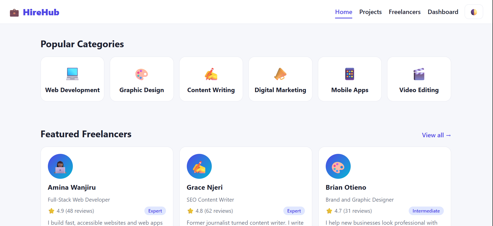

# 💼 HireHub: Freelancing Marketplace

A responsive freelancing marketplace where clients post projects and
freelancers browse opportunities, submit proposals and manage their profiles.
Built for the Sqrock IT Solutions Web Development Internship (Phase 2, Task 2).

**Live demo:** [add your link here]



## Features

- Homepage with hero, popular categories, featured freelancers and projects
- Project listing with search by title, filters for category and budget, and sorting
- Project details page with full description, skills, budget, deadline and client info
- Proposal form with validation, saved in LocalStorage
- Freelancer listing with search by skill, expertise level filter and profile pop-ups
  (portfolio samples, ratings and reviews)
- Dashboard with submitted proposals, posted projects, project status and profile
- Post a new project and change its status (Open, In Progress, Completed)
- Dark mode, mobile menu and a fully responsive layout

## Technologies

HTML5, CSS3 (Grid, Flexbox, CSS variables) and vanilla JavaScript (ES6).
Data is stored as JavaScript objects and in the browser's LocalStorage.

## Project structure

```
hirehub/
├── index.html
├── projects.html
├── project.html
├── freelancers.html
├── dashboard.html
├── css/style.css
├── js/
│   ├── layout.js       shared navbar, footer, dark mode, mobile menu
│   ├── data.js         projects, freelancers, reviews and helper functions
│   ├── home.js
│   ├── projects.js
│   ├── project.js
│   ├── freelancers.js
│   └── dashboard.js
└── screenshots/
```

## How it works

- One `project.html` page shows any project, using the id in the URL (`project.html?id=3`).
- The navbar and footer are written once in `layout.js` and used on every page.
- Proposals, posted projects, the profile and the theme are saved in LocalStorage,
  so they stay after a refresh. There is no backend, so data stays in the visitor's browser.

## Run locally

1. Clone the repo: `git clone https://github.com/[your-username]/hirehub.git`
2. Open `index.html` in your browser. No installation is needed.

## What I learned

- Building a multi-page site with shared components
- Passing data between pages with URL query strings
- Form validation and protecting against XSS by escaping user input
- Filtering, searching and sorting data
- Saving and reading data with LocalStorage
- Responsive design and dark mode with CSS variables

## Future improvements

A real backend with user accounts, messaging between clients and freelancers,
and payment integration.

## Author

[Your name] · [LinkedIn link] · [GitHub link]
